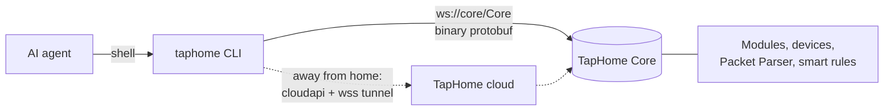

# taphome-config-cli

[](https://github.com/Damecek/taphome-config-cli/actions/workflows/ci.yml)
[](https://github.com/Damecek/taphome-config-cli/releases/latest)
[](LICENSE)

`taphome` is a command line tool that lets an AI agent configure a [TapHome](https://taphome.com) smart home. The agent adds virtual devices, imports Packet Parser templates, edits their scripts and writes smart rules. Before this tool, a person did that by hand in the TapHome app.

TapHome has no public configuration API. This project reverse engineered the protocol of the TapHome Android app, documented it as an OpenAPI 3.1 specification and built the CLI on top of it.

## What you get

- **A CLI for agents.** Every command prints one JSON document with a stable error code and exit code, so an agent can act on the result without parsing text.
- **Safe writes.** Every write has `--dry-run`, which prints the exact message and a diff and sends nothing. A real write checks its own result with a fresh read of the Core afterwards.
- **LAN and remote access.** The CLI talks to the Core on the home network, or through the TapHome cloud tunnel when you are away.
- **A documented protocol.** [`openapi/taphome-core.yaml`](openapi/taphome-core.yaml) describes 274 operations. Each one links to its evidence in the app code and says whether it was tested on a real Core.
- **An agent skill.** [`.agents/skills/taphome-cli/SKILL.md`](.agents/skills/taphome-cli/SKILL.md) tells an agent how to work on a live home: read freely, dry-run every write, ask the owner before sending it.

Day-to-day control, such as switching a light or setting a temperature, is out of scope. The tool configures the home, it does not operate it.

## How it works



The Core stores the whole configuration. The app and the CLI exchange binary protobuf messages with it over a WebSocket on port 80. The cloud only holds accounts and the list of locations, and it relays the same WebSocket for remote access. Details are in [`docs/architecture.md`](docs/architecture.md) and [`docs/protocol.md`](docs/protocol.md).

## Example

A typical change made by an agent: import a Packet Parser template, then check the new device.

```sh
taphome sync                                          # what the Core holds now
taphome pp inspect lamp.xml --param ApiKey=...        # offline: what the import would create
taphome pp import lamp.xml --param ApiKey=... --dry-run   # the exact message and a diff, nothing sent
taphome pp import lamp.xml --param ApiKey=...         # sent, then verified with a fresh sync
taphome io values "Demo lamp"                         # current value of the new device
taphome io errors "Demo lamp"
```

Every command answers with the same envelope. This is `pp inspect` on the test template in `tests/fixtures/pp/lamp.xml`, shortened:

```json
{
  "ok": true,
  "command": "pp inspect",
  "data": {
    "template": { "name": "Demo gateway", "revision": "1.2", "ccu_model": "PacketParserCCU" },
    "parameters": [
      { "id": "IpAddress", "label": "IP address", "value": "192.0.2.10" },
      { "id": "ApiKey", "label": "API key", "value": null }
    ],
    "modules": [ { "name": "Demo gateway", "model": "PacketParserModuleHttp" } ]
  },
  "warnings": []
}
```

Smart rules follow the same pattern: `taphome rule get "My rule" | jq .data.model > rule.json`, edit the file, then `taphome rule apply rule.json --dry-run`. Every command, flag and output field is in [`docs/cli.md`](docs/cli.md).

## Quick start

### 1. Install

On macOS and Linux, the script downloads the binary for your platform from the latest release, checks its SHA-256 and installs it to `~/.local/bin`.

```sh
curl -fsSL https://raw.githubusercontent.com/Damecek/taphome-config-cli/main/install.sh | sh
```

`TAPHOME_VERSION=v0.2.0` pins a release and `TAPHOME_INSTALL_DIR=/some/dir` changes the target directory. On Windows, download `taphome-x86_64-pc-windows-msvc.zip` from the [Releases page](https://github.com/Damecek/taphome-config-cli/releases). Releases are built for macOS (arm64, x86_64), Linux musl (arm64, x86_64) and Windows (x86_64).

### 2. Connect to your Core

On the home network, use a local account of the Core.

```sh
export TAPHOME_HOST=<core-address>
export TAPHOME_USER=<user>
export TAPHOME_PASSWORD=<password>
taphome auth login
```

Away from home, use a TapHome account (the e-mail you use in the TapHome app). It must be a user of the Core, with admin rights for writes. Leave `TAPHOME_HOST` unset.

```sh
export TAPHOME_CLOUD_EMAIL=<e-mail>
export TAPHOME_CLOUD_PASSWORD=<password>
export TAPHOME_LOCATION=<location>   # only when the account has several
taphome auth login
```

Each variable also has a `_FILE` variant that names a file holding the value. The password is never accepted as a command line argument. The first command after a cloud login can take about 10 seconds, later ones about a second.

### 3. Check the connection

```sh
taphome auth status --pretty
taphome sync --pretty
```

`sync` prints the counts of devices, interfaces and smart rules. If it fails with `connection_failed` and "No route to host" on macOS, see [Troubleshooting](#troubleshooting).

### Use it from an AI agent

Give the agent the skill in [`.agents/skills/taphome-cli/SKILL.md`](.agents/skills/taphome-cli/SKILL.md) and the credentials through its environment or its secret prompt, never in the chat. Claude Code picks the skill up automatically in this repository through `.claude/skills`.

## Safety model

The CLI works on a real home, so it refuses more than it allows.

- **Dry run first.** Every write command has `--dry-run`. It reads the current configuration, builds the message, prints it with a diff and sends nothing.
- **Verified writes.** After the Core answers, the CLI opens a new session, syncs again and checks the expected state. A failed check exits with code 8 and still reports what the Core answered.
- **Untested means refused.** Operations and variants never tested on a real Core fail with `unverified_operation` unless you pass `--allow-unverified`.
- **Raw access is gated.** `taphome raw call` sends any message class, but refuses writes without `--allow-write` and untested classes without `--allow-unverified`.
- **Secrets stay hidden.** Passwords, tokens, the session id, the password hash and the salt are redacted from all output.

Exit codes: 0 ok, 2 usage, 3 auth or config, 4 connection, 5 the Core rejected the request, 6 not found or ambiguous, 7 refused by a CLI gate, 8 verification failed.

## Status

Version 0.2.0. Tested against a real Core with software 2025.2.32396 (protocol version 89) on 2026-11-17 and 2026-11-18.

| Area | Status |
|---|---|
| Login and session, LAN | tested |
| Login and reads through the cloud tunnel | tested |
| Reads: devices, values, logs, errors, Packet Parser scripts, smart rules | tested |
| Virtual devices: create, rename, delete | tested |
| Packet Parser: import an HTTP module with devices, change a script | tested |
| Smart rules: create and delete a formula rule | tested |
| Other variants (other module types, other rule types, forced delete) | gated behind `--allow-unverified` |

54 of the 274 operations in the specification are tested. [`docs/verification.md`](docs/verification.md) is the full record.

## Documentation

| Document | Content |
|---|---|
| [`docs/cli.md`](docs/cli.md) | Every command, flag, output field, error code and configuration variable |
| [`docs/architecture.md`](docs/architecture.md) | Core, app, cloud and tunnel, network paths, discovery |
| [`docs/auth.md`](docs/auth.md) | Login methods, session flow, password hash and salt |
| [`docs/protocol.md`](docs/protocol.md) | Wire format, acknowledgements, errors, how changes are committed |
| [`docs/configuration-model.md`](docs/configuration-model.md) | Interfaces, devices, I/O, Packet Parser, Modbus and smart rules, with message sequences |
| [`docs/verification.md`](docs/verification.md) | What was tested on a real Core |
| [`docs/reverse-engineering.md`](docs/reverse-engineering.md) | How to reproduce the analysis of the Android app |
| [`docs/project-brief.md`](docs/project-brief.md) | The original goals of the project |

## Troubleshooting

- **`connection_failed` with "No route to host" on macOS.** macOS blocks LAN access for a process started by an app that has no Local Network permission. Grant it to the terminal or agent app under System Settings, Privacy and Security, Local Network, then restart that app.
- **`salt_missing` on login.** The binary was built from source without the password salt. Use a release binary, or see [Build from source](#build-from-source).
- **`unauthorized` or `RemoteAccessDisabled` through the cloud.** A local account cannot connect remotely. Use a TapHome account that is a user of the Core.
- **`core_offline`.** The Core is not connected to the TapHome cloud. Check its internet connection.
- **`session_invalid`.** The Core rejected the stored session and no password is set. Set the password variable and run `taphome auth login`.

## Development

```sh
cargo fmt
cargo clippy --all-targets -- -D warnings
cargo test
```

The tests use a fake Core on `127.0.0.1` and an invented salt, so they need no network and no secret.

- `data/catalog.json` is the protocol catalog compiled into the binary. Regenerate it from the spec with `uv run --with pyyaml scripts/build_cli_catalog.py`, and check that it is current with `--check`.
- `tests/vectors/codec.json` holds byte vectors for the codec tests. Regenerate it with `python3 scripts/build_codec_vectors.py`.
- CI (`.github/workflows/ci.yml`) runs fmt, clippy and the tests on pull requests and on `main`. It builds without a salt.
- The release workflow (`.github/workflows/release.yml`) runs on a `v*` tag. It builds the five targets, writes `SHA256SUMS` and publishes a GitHub release. The salt comes from the repository secret `TAPHOME_PASSWORD_SALT`, and `TAPHOME_REQUIRE_SALT=1` makes the build fail when the secret is missing.

### Build from source

Release binaries contain the TapHome password salt. The public source does not. A build reads the salt from `TAPHOME_PASSWORD_SALT` or from the file `~/.config/taphome/salt`. Where to find it is described in [`docs/auth.md`](docs/auth.md).

```sh
TAPHOME_PASSWORD_SALT='...' cargo install --git https://github.com/Damecek/taphome-config-cli
```

A build without the salt works for every command except login, which fails with `salt_missing`. Setting `TAPHOME_PASSWORD_SALT` at run time also works with such a build.

## Legal

This is an independent interoperability project and it is not affiliated with TapHome. APKs and decompiled sources stay local in `work/` (git-ignored) and are never committed. Only the API description and original code are published.

The original code and documentation are released under the [MIT License](LICENSE). TapHome is a trademark of its owner. The license does not cover TapHome software, which is not part of this repository.
