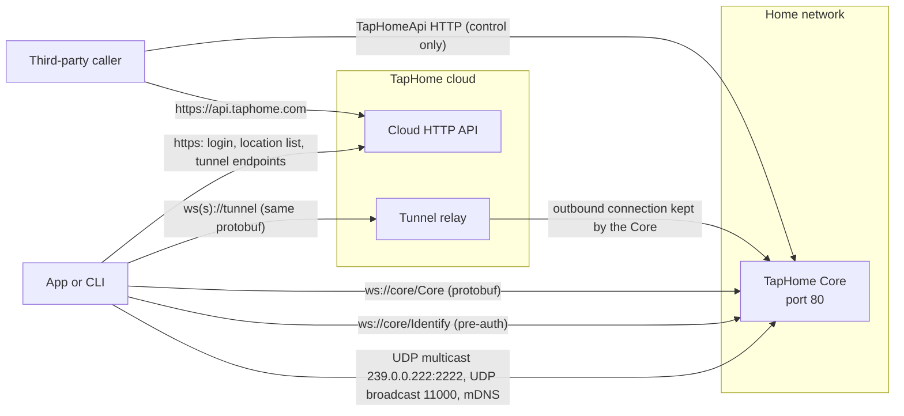

# Architecture

This page explains how the TapHome Android app, the TapHome Core and the TapHome cloud fit together, and which network paths a configuration client can use. It was reverse engineered from the app version 2025.2.32375 and checked against a Core running software 2025.2.32396.

Status values used in this document. "Confirmed" means seen on a live Core, and every confirmed fact is listed in `docs/verification.md`. Anything not marked confirmed is derived from the app code and not yet tested.

## Result in short

There is no REST API for configuration. The app opens a WebSocket to the Core on port 80 and exchanges binary protobuf messages. The Core stores the whole configuration. The cloud stores accounts and a location list, and it relays the same WebSocket when the phone is not on the home network.

## Components

| Component | Role | Status |
|---|---|---|
| App | Android client built with .NET (MAUI). It keeps a cache of the Core configuration and sends every change to the Core. | derived |
| Core | The smart-home controller. It runs a combined HTTP and WebSocket server (`websocket-sharp`). It owns devices, interfaces, smart rules, users, permissions and dashboards. | confirmed for the server banner, derived for the rest |
| Cloud | HTTPS API at `cloudapi.taphome.com` for accounts, the list of locations per user, push registration, tunnel endpoints, history access and firmware files. | derived |
| Tunnel | Relay servers that forward the Core WebSocket between the app and a Core that has an outbound connection to the cloud. | derived |
| Modules and devices | Hardware on the TapHome Bus, Modbus, KNX, ZigBee and other interfaces, plus virtual and Packet Parser devices. All of them are objects inside the Core. | derived |

## Where configuration lives

Every configuration change is a message to the Core. The app has about 190 methods that send such messages and none that write configuration to the cloud (derived). The Core keeps the data, so a client that can reach the Core never needs the cloud.

The cloud holds only this (derived).

- User accounts with password, name and language.
- For each user, the list of locations with the location id, name, last known LAN address, a masked setup token and an authorization token (a Guid) that proves access to one Core.
- Push notification registrations of client devices.
- The online status of each Core's tunnel connection.
- Value history in Azure Table Storage. The Core writes it, the app reads it with short-lived signed URLs.
- Firmware and update rule files. The app downloads them and uploads them to the Core over the Core WebSocket.

Backups are made and stored on the Core and transferred in chunks to the phone. The client has no cloud backup call.

## Network paths

### LAN path

The app connects to `ws://<core>/Core`. The scheme is plain `ws`, the port is always 80, and there is no query string. The LAN address comes from discovery, from the last successful connection, from the cloud location list or from the user. This path needs no cloud access (derived).

### Cloud path

The cloud API returns a list of tunnel URLs from `GET tunnelendpoints3`. The app picks one at random and uses it as the WebSocket URL. The message protocol on the tunnel is the same as on the LAN. The relay routes by the `LocationId` inside the first message (derived, the routing rule is inferred). A reconnect over the tunnel can end with `RemoteAccessDisabled` (reconnect result 5) when the user has remote access switched off. Whether the Core or the relay sends it is not known.

### How the app chooses (derived)

1. The app starts the local socket first, after a random exponential back-off of 50 ms to 4 s.
2. It schedules the cloud socket after `max(cloud back-off minus local back-off, 300 ms)`, with a cloud back-off of 50 ms to 8 s. It opens the cloud socket only if the local socket is not connected yet.
3. The first socket that completes the reconnect handshake becomes the working socket.
4. If the local socket wins, the app closes the cloud socket. Local always has priority.
5. The local address is chosen in this order. The last successful address, then the discovery result if it differs, then the address from the cloud location list.
6. On "connection refused" or a timeout, the app runs discovery again after 20 s. Otherwise it runs discovery every 120 s.

A CLI that talks to a Core on its own network can skip all of this and connect to one address.

## Discovery (derived)

The app runs three mechanisms in parallel and merges the results by `LocationId`. Each takes up to 5 s and the whole search up to 10 s.

| Mechanism | Detail |
|---|---|
| UDP multicast | Group `239.0.0.222`, port 2222. The request is the JSON text `{"Type":"TapHome Discovery Request","LocationId":null}` encoded as UTF-16 little endian. The app sends it twice. Responses are JSON in UTF-16 little endian. |
| UDP broadcast | The subnet broadcast address on port 11000, which is also the local bind port. The request is the same JSON in UTF-8. The Core's address is the datagram source address. |
| mDNS | Service `_th-discovery._tcp.local.`. The TXT records carry `Name`, `AccessToken`, `LocationId` and `IpOnLocalNetwork`. |

The response JSON has the shape `{"Type":"TapHome Discovery Response","LocationInfo":{"LocationId":...,"Name":...,"IpOnLocalNetwork":...,"AccessToken":...,"DnsName":...}}`. The `AccessToken` is masked. A location name of `<New installation>` marks a Core that was never set up. Discovery carries no port and no version.

When the user types an address instead, the app opens `ws://<core>/Identify`. The Core sends one binary frame that is a bare `LocationInfo`, and the app closes the socket. Confirmed: this frame has the location id, the name and the address, a masked `AccessToken` and no `AuthorizationToken`.

## WebSocket endpoints

All four endpoints are on port 80. The WebSocket handshake carries no credentials and no sub-protocol. Authentication happens inside the messages (see `docs/auth.md`).

| Endpoint | Purpose | Payload | Status |
|---|---|---|---|
| `/Core` | Login, session reconnect, all configuration and control messages, broadcasts. | `MessageBase` | confirmed for login and reconnect, derived for the rest |
| `/Identify` | Pre-auth identification. The Core sends one frame after the connection opens. | bare `LocationInfo` | confirmed |
| `/SetUp` | First setup of a Core that has no configuration, with the full setup token. | `MessageSetupNewLocationRequest`, then `MessageGenericResponse` | derived |
| `/ForgottenPassword` | Admin password reset with the setup token. | `MessageForgottenPasswordRequest`, `MessageSetNewPasswordRequest` | derived |

## HTTP surface of the Core

| Path | What it is | Status |
|---|---|---|
| `GET /` | An HTML status page with the location name, uptime and local time. The `Server` header is `websocket-sharp/1.0`. | confirmed |
| `GET /api/TapHomeApi/v1/getDeviceValue/{externalId}` and `getOneDeviceValue/{externalId}` | Read a value of an exposed device. | derived |
| `GET /api/TapHomeApi/v1/setDeviceValue/{externalId}` | Set a value of an exposed device. | derived |

The TapHomeApi is configured in the app as a "slave interface" of type `TapHomeApi`. The owner chooses which devices to expose and gives each an `externalId`. A request carries the interface token in the `token` query parameter. The same routes exist on `https://api.taphome.com` when cloud access is enabled for the interface. The interface can also call a webhook on changes.

TapHomeApi is control only. It reads and sets values of devices the owner exposed. It cannot create or edit devices, interfaces, smart rules, users, dashboards or Core properties, so it is not a configuration channel. The routes are listed in the OpenAPI document as ordinary HTTP paths. The messages that the cloud tunnels to the Core on behalf of Alexa, Make (Integromat) and the TapHomeApi are runtime calls and mostly left out of the spec (see `openapi/operations/EXCLUDED.md`). The four `MessageTapHomeApi...` read messages that are in the spec (`tapHomeApiLocationInfo`, `tapHomeApiDiscovery`, `tapHomeApiGetDeviceValue`, `tapHomeApiGetMultipleDeviceValues`) are marked tunnel only. A normal client session got no answer to them within 60 s on Core 2025.2.32396 (confirmed), so a LAN client cannot use them.

## Official and Next lines

TapHome ships two app lines. The analysis covers both, and the spec describes the Official line.

| | Official | Next |
|---|---|---|
| App version analysed | 2025.2.32375 | 2026.1.41842 |
| Core software seen | 2025.2.32396 (confirmed) | not seen |
| Protocol version | 89 | 97 |
| Serializer | protobuf-net, precompiled | GProtobuf, source generated |
| Message classes | about 380 | about 420 |

- The wire format is compatible (derived). Next keeps the protobuf-net layout. It writes the subtype field first, then `RequestsId`, and encodes Guid, DateTime and TimeSpan the same way. One difference is that Next always writes both the value and the scale of a `TimeSpan`, while protobuf-net omits zero values. Readers accept both.
- The shared messages keep their include tags (100 to 111 are identical). Next adds messages, for example device value snapshots, smart rule logs, system logs and update operations, and adds a field `LanguageCode` to the login request.
- Next adds `MessageCompressed` (include tag 99, protocol 90 or higher). It carries a Brotli-compressed serialized `MessageBase`, optionally split into chunks. A client that declares protocol 89 probably never receives it (derived, untested).
- A Core that reports a protocol version of 90 or higher runs Next-line firmware, and 89 or lower is Official. The protocol numbers form one linear sequence.
- Confirmed: a client cannot read the protocol version before login. A reconnect with an unknown session returns no version fields, so the line is known only after the first successful reconnect.
